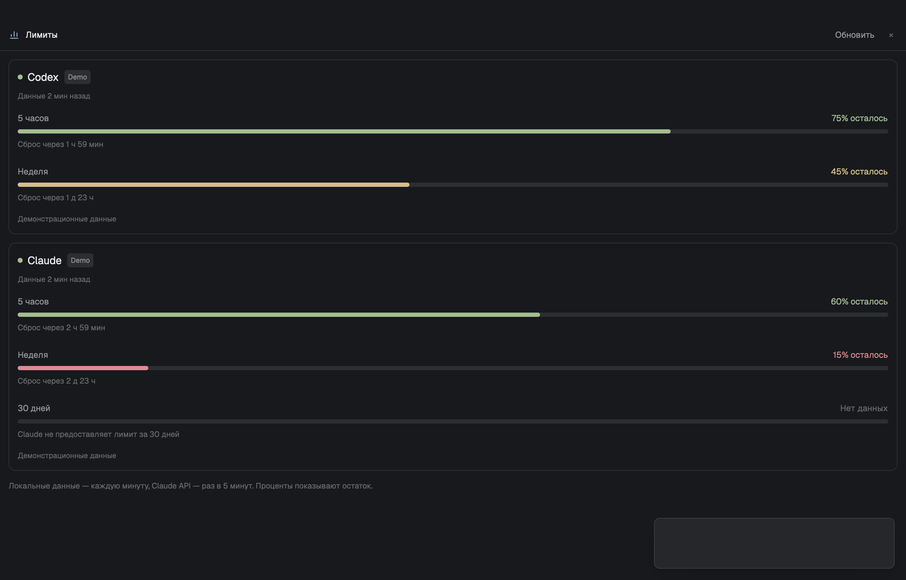

# Herdr Usage Limits — Лимиты

A Herdr sidebar mod for Codex and Claude remaining quotas. Russian UI, theme-aware bars, reset countdowns, and automatic refresh.

## Install

Ask your agent to read your Herdr `AGENTS.md`, this repository's [RECIPE.md](RECIPE.md), and every source file, then install `mods/usage-limits/` into your Herdr home and add it to your personal layout. The preferred sidebar width is 368px. The close button expects its host layout node to be named `panel`; adapt it when necessary. No layout or keyboard configuration is replaced.

Requires Python 3 and existing Codex or Claude Code usage. The mod reads local Codex session quota events and Claude Code account metadata, and calls the Anthropic usage endpoint using the existing local Claude Code OAuth token. On macOS it can read that token through Keychain's `security` command. It never prints or caches the token. Quota and account metadata are cached locally; keep these files private.

Codex data refreshes from local sessions every minute; Claude API requests are cached for five minutes (15 minutes after HTTP 429). Codex values can lag actual usage. A Claude monthly row represents extra-usage budget when supplied; unavailable quotas are shown explicitly.

Read the recipe for behavior, dependencies, limits, and validation. The screenshot uses demo data; the distributed collector reads the installing user's own data.
