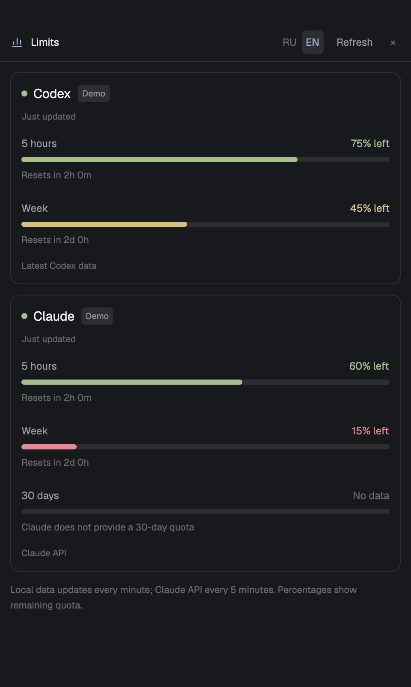

# Usage Limits — Лимиты

A bilingual English/Russian Herdr panel showing the remaining Codex and Claude account quotas, with colored progress bars, reset countdowns, data age, and a manual refresh button. It follows the current Herdr theme. The preview uses demonstration values, not account data.

## What you see

A vertical panel designed for a 368px sidebar, with a 44px header: a small chart icon, «Лимиты» / “Limits”, RU and EN language buttons, «Обновить» / “Refresh”, and ×. Highlight the selected language with the theme accent and raised background; hover labels are “Русский” and “English”. The scrollable body has 12px padding and two rounded cards, Codex then Claude. Cards have a 1px theme border, 12px padding, 15px semibold service names, an optional plan badge, a freshness dot, and data age. Quota rows show the period, remaining percentage, a 6px bar, and a reset countdown with the exact local reset time on hover. Theme colors supply the surface, text, borders, and status colors. Remaining quotas above 50% are green, 21–50% yellow, and 20% or below red. Unknown data is dimmed.

## How it behaves

RU and EN switch every interface message immediately, without collecting quotas again or discarding loaded data. Persist the language under `language` in the mod copy's `localStorage`. On initialization choose a valid saved value first, then `props.language` (`en` or `ru`), otherwise `ru`. Translate periods, remaining quota, countdown units, data age, unavailable/expired states, sources, errors, footer, and the close tooltip. Format reset-date tooltips with `en-US` or `ru-RU`. Keep service names and provider-supplied plan names unchanged.

Load immediately and poll every 60 seconds; Refresh performs another collection unless one is already running. The button reads «Обновление…» during collection. Display remaining percentage as 100 minus used percentage, clamped to 0–100. An expired reset hides the old percentage and displays a waiting message. Service data older than 15 minutes has a dim freshness dot. Failed collection shows an error; unavailable provider data shows explanatory text. Claude has 5-hour, weekly, and 30-day rows. The 30-day row uses the extra-usage monthly budget when available, and explains when no monthly quota is supplied. Agent working/blocked/done/idle statuses do not affect this panel. No keyboard bindings are required. The × button hides the layout node named `panel`.

## Built from

Ship `mods/usage-limits/main.js`, `i18n.js`, `mod.json`, `collect.py`, and `icon.svg`. The JavaScript default export extends gpui-kit `View`, uses `div`, `svg`, and gpui-base flex builders, and calls Herdr `theme`, `exec`, `appHome`, `checking`, and `run`. `i18n.js` owns both message dictionaries, interpolation, and duration formatting. The collector returns language-independent message keys or objects such as `{key: "claude_http", code: 429}` and `{key: "days", count: 3}`. Translate when rendering, so cached errors change language too. Convert old Russian cache errors to message keys without discarding quota data or retry deadlines. Guard collection during `checking()`. Run `python3 -B <appHome>/mods/usage-limits/collect.py` through `exec` with a 25-second timeout; parse its JSON `services` array. Use instance timers and asynchronous tasks, never retain a context for later use.

The Python collector uses only the standard library. Codex data comes from the most recently modified 40 JSONL session files under `$CODEX_HOME/sessions` (default `~/.codex/sessions`), reading the final 2MiB of each, and selecting the latest matching rate-limit event encountered. Derive labels from window length and preserve its timestamp and reset time.

Claude reads its existing OAuth token from `~/.claude/.credentials.json`, falling back to the macOS `security find-generic-password` command for `Claude Code-credentials`. It reads account metadata from `~/.claude.json`. Request `https://api.anthropic.com/api/oauth/usage` using the token as a Bearer credential and the `anthropic-beta: oauth-2025-04-20` header. Cache selected quota fields, timestamp, account UUID, errors, and retry time in `.claude-cache.json` beside the collector. Tokens stay in memory and must never enter output or cache. Request at most every five minutes; HTTP 429 backs off for 15 minutes. Optional fallback data comes from `~/.cache/over9k/usage/claude.json`; no over9k installation is required. Return provider-specific errors without exposing credentials.

## Watch out

Requires Python 3 in Herdr's environment and existing Codex/Claude Code activity or login. This mod runs a local program, reads files outside its own folder, and contacts Anthropic using the user's existing Claude Code authorization. Codex numbers are last-observed session data, not a live quota endpoint. Provider endpoints and local formats can change. Claude authorization is not refreshed by this mod. The cache is local account metadata: never publish it.

The shipped `mod.json` has `place: none`, so installation alone does not dock the panel. Add a block with `content: {"mod":"usage-limits"}` to the person's personal layout, ideally a 368px sidebar in a node named `panel`; adapt the close action if its node has another name. Clone a shipped layout before changing its structure. This repository deliberately contains no `layouts/` folder and no replacement `keys.json`. Do not overwrite another mod with the same name; rename its folder and internal asset/collector paths together. Do not ship generated type definitions, editor configuration, caches, credentials, or session logs.

## Done when

- `herdr-app check <installed mod folder>` passes.
- The panel renders in Herdr and follows theme colors without errors in `herdr-app status`.
- A Codex session with rate-limit events produces the expected remaining percentages and reset countdowns.
- With a valid Claude Code login, quota data loads; without it, explanatory text appears without crashing.
- Refresh and the minute timer update data; the Claude cache throttles requests.
- Expired and missing quotas render as unavailable rather than misleading zeroes.
- The close button hides the host node named `panel`.
- RU/EN changes loaded quota labels and errors immediately; the choice survives a panel restart. `props.language: en` starts a new unsaved panel in English.
- Fixture tests cover language switching, persistence, initial language, loading/expired/error states, countdowns, and legacy cache errors without extra API calls.
- Public files contain no tokens, caches, account UUIDs, or session records. The preview contains demonstration data only.
